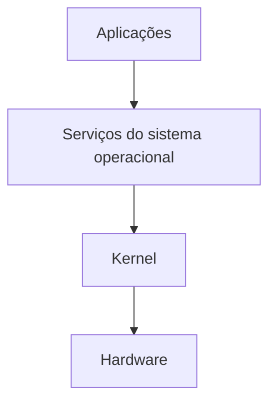

# 📘 Aula 01 — Introdução aos sistemas operacionais

[← Índice da disciplina](../README.md) · [Aula 02 →](../Aula-2/README.md)

Esta aula apresenta os conceitos fundamentais de um **sistema operacional (SO)**, sua relação com o hardware e as funções necessárias para executar e gerenciar programas.

## 📌 O que é um sistema operacional?

É o conjunto de softwares responsável por gerenciar recursos do computador, fornecer serviços às aplicações e organizar a interação com os dispositivos físicos. Windows, Linux, macOS, Android e iOS são exemplos de sistemas operacionais.

## 🧠 Conceitos principais

| Conceito | Explicação |
|---|---|
| **Kernel** | Núcleo do sistema operacional, responsável por funções essenciais e operações privilegiadas. |
| **Modo usuário e modo kernel** | Níveis de privilégio que ajudam a proteger recursos do sistema. |
| **Escalonamento** | Define como o tempo de CPU é distribuído entre processos ou tarefas. |
| **Memória** | Envolve alocação, proteção e técnicas como paginação e memória virtual. |
| **Entrada e saída** | Permite a comunicação com dispositivos, com auxílio de drivers. |
| **Sistema de arquivos** | Organiza e possibilita o acesso aos dados armazenados. |
| **Segurança e virtualização** | Relacionam-se à proteção dos recursos e à criação de ambientes de execução. |



O diagrama simplifica a relação entre esses componentes e não representa uma arquitetura única para todos os sistemas operacionais.

## 📂 Materiais disponíveis

| Arquivo | Conteúdo |
|---|---|
| [`Linha-do-tempo.md`](Linha-do-tempo.md) | Marcos da evolução histórica dos sistemas operacionais. |
| [`Linha-do-tempo-imagem.png`](Linha-do-tempo-imagem.png) | Representação visual da linha do tempo. |

O texto da linha do tempo apresenta algumas referências repetidas a Android e iOS; o material original foi mantido.

## 📝 Atividades da aula

A proposta inclui formar grupos de **três a cinco integrantes**, informar os nomes dos participantes, criar um repositório GitHub para a disciplina e elaborar uma linha do tempo com apoio do Miro, disponibilizando-a em Markdown.

A expressão de avaliação apresentada no material é:

```text
Média = (P1 × 0,25) + (P2 × 0,25) + ((PJ + AT) × 0,25)
```

**Professor:** Me. Deivison S. Takatu · [deivison.takatu@fatec.sp.gov.br](mailto:deivison.takatu@fatec.sp.gov.br)

[Continuar para a Aula 02 →](../Aula-2/README.md)
