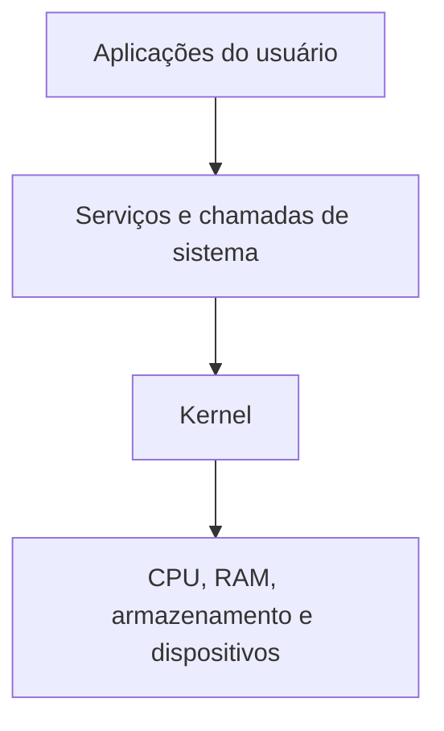

# Aula 01 — Introdução aos Sistemas Operacionais

[Índice da disciplina](../README.md) · [Aula 02](../Aula-2/README.md)

## 🎮 Fase 01 · Fundamentos do SO

> **Meta de aprendizado:** Construa um mapa mental relacionando aplicações, kernel e recursos de hardware. XP abaixo são **simbólicos**, não ligados às notas da disciplina.

| Nível | Missão com evidência | Material | XP |
|---|---|---|--:|
| Identificar | Diferenciar modo usuário e modo kernel | [Resumo desta aula](#estrutura-e-funções) | 15 |
| Relacionar | Associar CPU, memória e E/S às funções do SO | [Estrutura](#estrutura-e-funções) | 15 |
| Historicizar | Consultar os marcos cronológicos | [Linha do tempo](Linha-do-tempo.md) | 20 |

**Checkpoints pessoais**

- [ ] Expliquei o papel do kernel em poucas frases.
- [ ] Diferenciei escalonamento de gerenciamento de memória.
- [ ] Consultei a linha do tempo em texto ou imagem.

<details>
<summary><strong>🏅 Missão extra para aprofundamento</strong></summary>

Organize um diagrama próprio de interação entre aplicação, serviço do SO e dispositivo de hardware.

</details>

**Observação:** O fluxograma deste README é didático e não descreve a arquitetura específica de uma versão de Windows, Linux ou macOS.

---


Apresentação da disciplina e dos conceitos fundamentais de sistemas operacionais.

## Materiais

| Arquivo | Conteúdo |
|---|---|
| [Linha-do-tempo.md](Linha-do-tempo.md) | Linha do tempo com marcos da evolução dos sistemas operacionais. |
| [Linha-do-tempo-imagem.png](Linha-do-tempo-imagem.png) | Representação visual da linha do tempo. |

## O que é um sistema operacional?

O sistema operacional gerencia os recursos do computador e fornece serviços para a execução dos programas. Ele intermedeia a comunicação entre as aplicações e o hardware.

Os exemplos apresentados na aula são Windows, macOS, Linux, Android e iOS.

## Estrutura e funções

| Tema | Conceito |
|---|---|
| Estrutura em camadas | Organização das funções do sistema em níveis. |
| Kernel | Núcleo responsável pelo gerenciamento dos recursos e pelas operações privilegiadas. |
| Modo usuário | Execução das aplicações com acesso limitado aos recursos protegidos. |
| Modo kernel | Execução de operações com privilégios elevados. |
| Escalonamento | Distribuição do tempo da CPU entre os processos; a aula cita FIFO, Round Robin e prioridade. |
| Gerenciamento de memória | Alocação e proteção da RAM, além de memória virtual, paginação e segmentação. |
| Entrada e saída | Comunicação com os dispositivos do computador. |
| Sistema de arquivos | Organização dos dados armazenados e acesso a eles. |
| Segurança e virtualização | Proteção dos recursos e organização de ambientes de execução. |

## Avaliação

```text
Média = (P1 × 0,25) + (P2 × 0,25) + ((PJ + AT) × 0,25)
```

- **P1 e P2:** provas.
- **PJ:** projeto.
- **AT:** atividades.

## Atividades propostas

1. Formar grupos de três a cinco integrantes e manter a mesma composição nas atividades do semestre.
2. Enviar os nomes completos dos integrantes.
3. Criar o repositório da disciplina no GitHub e publicar o resumo da aula em Markdown.
4. Construir uma linha do tempo no Miro e salvar sua versão em Markdown no repositório.

## Linha do tempo

A [versão textual](Linha-do-tempo.md) e a [imagem](Linha-do-tempo-imagem.png) são materiais de apoio ao estudo. O texto contém uma repetição de iOS e Android nas entradas de 2007/8 e 2021; essa duplicação permanece no arquivo da atividade.

**Professor:** Me. Deivison S. Takatu — [deivison.takatu@fatec.sp.gov.br](mailto:deivison.takatu@fatec.sp.gov.br).

---

## Como as camadas se relacionam



O diagrama é **didático**: simplifica a organização conceitual apresentada na aula, sem representar a arquitetura exata de todo sistema operacional.

## Roteiro de revisão

| Pergunta para estudo | Conceito envolvido |
|---|---|
| Quem gerencia processos e memória? | Kernel e gerenciamento de recursos |
| Por que aplicações não acessam livremente recursos privilegiados? | Modo usuário e modo kernel |
| Como diferentes processos dividem a CPU? | Escalonamento |
| Como dados são organizados no armazenamento? | Sistemas de arquivos |
| O que possibilita usar periféricos? | Entrada/saída e drivers |

**Material visual:** [abrir a linha do tempo ilustrada](Linha-do-tempo-imagem.png) · [versão escrita](Linha-do-tempo.md).

Para aprofundar os marcos históricos, siga para a [Aula 02](../Aula-2/README.md).
