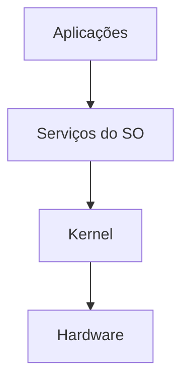

# 📘 Aula 01 — Introdução aos Sistemas Operacionais

[← Índice da disciplina](../README.md) · [Aula 02 →](../Aula-2/README.md)

Apresentação da disciplina e dos principais conceitos de gerenciamento de recursos em sistemas operacionais.

## 📌 O que é um sistema operacional?

É o software responsável por organizar o uso de recursos do computador e oferecer serviços aos programas, intermediando aplicações e hardware. Exemplos citados no material: Windows, macOS, Linux, Android e iOS.

## 🧠 Conceitos abordados

| Conceito | Explicação |
|---|---|
| Kernel | Núcleo que gerencia recursos e operações privilegiadas |
| Modo usuário / kernel | Níveis de privilégio e proteção de recursos |
| Escalonamento | Distribuição do tempo de CPU; exemplos FIFO, Round Robin e prioridade |
| Memória | Alocação, proteção, paginação, segmentação e memória virtual |
| Entrada e saída | Comunicação com dispositivos, com apoio de drivers |
| Sistema de arquivos | Organização dos dados persistidos |
| Virtualização e segurança | Controle de acesso e ambientes de execução |



O diagrama é uma simplificação didática, não uma representação exata de todo kernel.

## 📂 Material da aula

| Arquivo | Descrição |
|---|---|
| [Linha-do-tempo.md](Linha-do-tempo.md) | Marcos da evolução dos sistemas operacionais |
| [Linha-do-tempo-imagem.png](Linha-do-tempo-imagem.png) | Representação gráfica da linha do tempo |

O texto da linha do tempo contém entradas repetidas de Android/iOS; a duplicação foi mantida no arquivo original.

## 📝 Atividades e avaliação

A proposta da aula inclui formar grupos de **três a cinco integrantes**, enviar nomes, criar um repositório GitHub para a disciplina e construir uma linha do tempo (com referência a Miro), exportando-a em Markdown.

```text
Média = (P1 × 0,25) + (P2 × 0,25) + ((PJ + AT) × 0,25)
```

**Professor:** Me. Deivison S. Takatu — [contato institucional](mailto:deivison.takatu@fatec.sp.gov.br).
