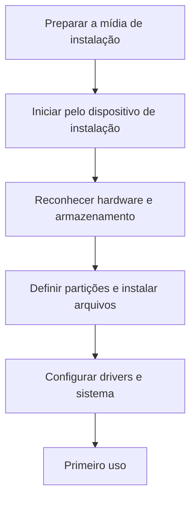

# Aula 04 — Instalação e ramificações de Sistemas Operacionais

[Aula 03](../Aula-3/README.md) · [Índice da disciplina](../README.md) · [Aula 05](../Aula-5/README.md)

Atividades sobre a instalação do Windows e as relações entre sistemas operacionais.

## Materiais

| Arquivo | Tema |
|---|---|
| [Atividade-1.md](Atividade-1.md) | Formatação e instalação do Windows, relacionadas aos conceitos de sistemas operacionais. |
| [Atividade-2.md](Atividade-2.md) | Levantamento de bases e influências de sistemas operacionais. |

## Atividade 1 — Instalação do Windows

A atividade descreve o percurso entre a preparação da mídia de instalação e o primeiro uso do Windows. As etapas incluem inicialização pelo pendrive, reconhecimento do hardware, escolha da unidade, particionamento ou formatação, cópia dos arquivos e configuração dos drivers.

A explicação relaciona esse processo a sete temas:

1. Componentes do sistema operacional.
2. Kernel.
3. Modos de execução.
4. Processos.
5. Diferenças entre programa, processo e thread.
6. Sistema de arquivos.
7. Dispositivos de entrada e saída e seus drivers.

### Entrega

O documento solicita a descrição do processo, a explicação dos conceitos, uma linha do tempo, uma tabela que relacione as etapas aos conceitos e as respostas ao desafio final.

### Critérios de avaliação

| Critério | Pontos |
|---|---:|
| Descrição do processo | 2 |
| Componentes do sistema operacional | 2 |
| Relação entre os conceitos | 3 |
| Linha do tempo e tabela | 1 |
| Desafio final | 1 |
| Organização e Markdown | 1 |
| **Total** | **10** |

O texto completo também apresenta explicações e respostas aos desafios.

## Atividade 2 — Ramificações

A [atividade de ramificações](Atividade-2.md) contém uma tabela com cinco sistemas: PS5, Nintendo Switch, Xbox Series S, Android e Steam Deck. O arquivo inicia uma representação em árvore do primeiro item, mas não apresenta as demais árvores.

Consulte o documento para acompanhar o levantamento disponível.

---

## Etapas e conceitos em um fluxo

| Etapa conceitual | Relação com sistemas operacionais | Material |
|---|---|---|
| Inicialização | Firmware, carregamento e kernel | [Atividade 1](Atividade-1.md) |
| Reconhecimento dos dispositivos | Drivers e comunicação com o hardware | [Atividade 1](Atividade-1.md) |
| Escolha do armazenamento | Partições e sistemas de arquivos | [Atividade 1](Atividade-1.md) |
| Execução de programas | Processos, threads e modos de execução | [Atividade 1](Atividade-1.md) |
| Ramificações de plataformas | Bases e influências entre sistemas | [Atividade 2](Atividade-2.md) |

> **Cuidado em instalações reais:** operações de formatação e particionamento podem apagar arquivos. Faça backup e confira o disco de destino antes de executar procedimentos práticos. O conteúdo desta pasta é apresentado como **atividade acadêmica**.

## Referências de navegação

[Atividade 1 — instalação e conceitos](Atividade-1.md) · [Atividade 2 — ramificações](Atividade-2.md) · [Índice da disciplina](../README.md).
