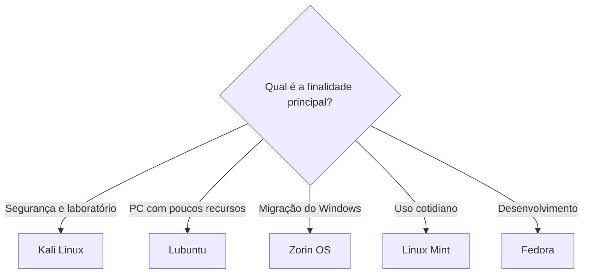

# Aula 05 — Comparativo de distribuições Linux

[Aula 04](../Aula-4/README.md) · [Índice da disciplina](../README.md) · [Aula 06](../Aula-6/README.md)

## 🎮 Fase 05 · Laboratório de escolhas Linux

> **Objetivo:** Avalie alternativas pelo cenário de uso, não apenas por preferência visual ou notas qualitativas. XP indica **progresso didático opcional** e não é calculado automaticamente nem faz parte da avaliação oficial.

| Checkpoint | Missão | Evidência consultável | XP |
|---|---|---|--:|
| Cenário 1 | Indicar Linux para máquina com poucos recursos | [Lubuntu](https://lubuntu.me/) | 15 |
| Cenário 2 | Escolher para migração a partir do Windows | [Zorin OS](https://zorin.com/os/) | 15 |
| Cenário 3 | Diferenciar segurança e desenvolvimento | [Kali](https://www.kali.org/) · [Fedora](https://fedoraproject.org/) | 20 |
| Auditoria | Explicar limitações das notas 1–5 | [Quadro comparativo](#comparação-por-critérios) | 20 |

**Progresso manual**

- [ ] Consigo justificar uma escolha com base em hardware e uso.
- [ ] Não tratei a tabela qualitativa como benchmark.
- [ ] Consultei a documentação oficial de pelo menos uma distribuição.

<strong>🏅 Desafio opcional de excelência</strong>

Montar uma ficha de requisitos para um computador real e verificar requisitos da distribuição em seu site oficial.

**Nota técnica:** As classificações reproduzem um exercício qualitativo; não devem ser apresentadas como benchmarks medidos.

---

Comparação de Kali Linux, Lubuntu, Zorin OS, Linux Mint e Fedora, considerando os perfis de uso discutidos no material da aula.

## Distribuições analisadas

| Distribuição | Foco apresentado | Vantagens destacadas | Pontos de atenção |
|---|---|---|---|
| [Kali Linux](https://www.kali.org/) | Segurança da informação, testes de invasão, análise de redes e forense digital. | Ferramentas de segurança e comunidade. | Pode exigir familiaridade com o Linux; não é a opção principal apresentada para uso doméstico ou jogos. |
| [Lubuntu](https://lubuntu.me/) | Baixo consumo de recursos e uso em computadores modestos. | Leveza, baixo consumo de RAM e base Ubuntu. | Interface mais simples e menos recursos integrados. |
| [Zorin OS](https://zorin.com/os/) | Facilidade de uso e adaptação para usuários vindos do Windows. | Interface amigável, base Ubuntu e uso doméstico. | Alguns recursos dependem da versão escolhida; pode consumir mais recursos do que distribuições leves. |
| [Linux Mint](https://linuxmint.com/) | Uso diário, estabilidade e produtividade. | Interface tradicional, facilidade de aprendizado e equilíbrio entre recursos e desempenho. | Não é a opção mais leve e pode receber algumas tecnologias mais tarde. |
| [Fedora](https://fedoraproject.org/) | Desenvolvimento e tecnologias recentes. | Ambiente para programação, comunidade e relação com o ecossistema Red Hat. | Atualizações frequentes e possíveis ajustes conforme o hardware. |

## Comparação por critérios

A tabela preserva as avaliações qualitativas do material da aula. A escala varia de **1 a 5** e não corresponde a resultados de testes de desempenho.

| Critério | Kali Linux | Lubuntu | Zorin OS | Linux Mint | Fedora |
|---|---:|---:|---:|---:|---:|
| Facilidade para iniciantes | 2 | 4 | 5 | 5 | 3 |
| Uso em computadores com poucos recursos | 3 | 5 | 3 | 4 | 3 |
| Uso diário | 2 | 4 | 5 | 5 | 4 |
| Jogos | 2 | 3 | 4 | 4 | 4 |
| Programação | 4 | 3 | 4 | 4 | 5 |
| Segurança | 5 | 2 | 2 | 2 | 4 |
| Trabalho | 3 | 3 | 4 | 4 | 5 |
| Personalização | 5 | 4 | 4 | 4 | 4 |

## Indicações por finalidade

| Finalidade | Distribuições indicadas no material |
|---|---|
| Segurança da informação e testes de invasão | Kali Linux |
| Computador antigo ou com poucos recursos | Lubuntu |
| Primeiro contato com o Linux e migração do Windows | Zorin OS |
| Estudos e tarefas diárias | Linux Mint e Zorin OS |
| Programação e trabalho técnico | Fedora |
| Trabalho administrativo | Linux Mint |
| Jogos | Zorin OS e Linux Mint; Fedora também é citado para usuários mais experientes. |

O desempenho dos jogos depende do hardware, dos drivers, da compatibilidade do jogo e da configuração do sistema.

---

## Árvore de decisão didática

O fluxo apenas **resume os perfis apresentados no material**, não é um benchmark ou uma classificação universal.

## Links oficiais

| Distribuição | Projeto | Documentação |
|---|---|---|
| Kali Linux | [Site](https://www.kali.org/) | [Docs](https://www.kali.org/docs/) |
| Lubuntu | [Site](https://lubuntu.me/) | [Manual](https://manual.lubuntu.me/) |
| Zorin OS | [Site](https://zorin.com/os/) | [Ajuda](https://help.zorin.com/) |
| Linux Mint | [Site](https://linuxmint.com/) | [Guia](https://linuxmint-installation-guide.readthedocs.io/) |
| Fedora | [Site](https://fedoraproject.org/) | [Docs](https://docs.fedoraproject.org/) |

### Como interpretar as notas da comparação

As notas de 1 a 5 no quadro original são **avaliações qualitativas da atividade**, não medições reproduzíveis. Para escolher uma distribuição de verdade, confira requisitos atuais, drivers, suporte do hardware e necessidades pessoais.

[← Aula 04](../Aula-4/README.md) · [Índice da disciplina](../README.md) · [Aula 06 →](../Aula-6/README.md).
