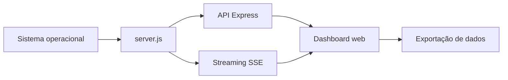

# 📊 NEXUS OS Omega V3 — Projeto da Aula 07

[← Aula 07](../README.md) · [↑ Índice da disciplina](../../README.md)

Dashboard web em português para analisar **informações do sistema operacional, runtime Node.js, processos e requisições HTTP**. A versão declarada em [package.json](package.json) é **3.1.0**.

[](https://nodejs.org/) [](https://expressjs.com/) 

## ✨ Funcionalidades

| Módulo | Informações |
|---|---|
| CPU | Utilização, dados por núcleo, média, pico e carga |
| Memória | RAM e memória do processo Node.js |
| Runtime | Node/V8, event loop, garbage collection e heap |
| Sistema e rede | Hostname, plataforma, kernel, arquitetura, uptime e interfaces |
| HTTP | Volume e duração de requisições do próprio Express |
| Processos | Lista, filtro e ordenação, sem ações de encerramento |
| Arquivos | Quantidade, tamanho e extensão dos arquivos do projeto |
| Armazenamento | Espaço do volume, quando suportado |
| Relatórios | JSON, comparação por importação e CSV de sessões |

A interface inclui **cinco temas** (Cyber Cyan, Quantum Violet, Matrix Emerald, Crimson Reactor e Solar Gold), intensidade de neon, modo observação, apresentação, tela cheia, pausa e paleta `Ctrl+K` / `Cmd+K`.

## 🧱 Arquitetura



A aplicação está concentrada em [server.js](server.js), que contém servidor, APIs e interface (HTML/CSS/JavaScript). O arquivo [package.json](package.json) define Express `^5.1.0`, Helmet `^8.1.0`, Node.js `>=18` e scripts de execução.

## ⚙️ Instalar e executar

Na pasta deste README:

```bash
npm ci
npm start
```

Servidor: `0.0.0.0`, porta padrão `3000` (ou valor de `PORT`). Abra `http://localhost:3000`.

Para recarga automática durante o desenvolvimento:

```bash
npm run dev
```

Esse script utiliza `node --watch server.js`. Não há script de teste automatizado declarado.

## 🌐 Rotas HTTP

| Método | Endpoint | Finalidade |
|---|---|---|
| `GET` | `/` | Interface principal |
| `GET` | `/api/dashboard` | Telemetria em JSON |
| `GET` | `/api/public-snapshot` | Resumo no esquema `nexus-os-live-v3` |
| `OPTIONS` | `/api/public-snapshot` | Preflight (204) |
| `GET` | `/api/stream` | Eventos SSE `telemetry` e `fault` |
| `GET` | `/api/health` | Resposta com status do serviço |

```bash
curl http://localhost:3000/api/health
curl http://localhost:3000/api/dashboard
curl -N http://localhost:3000/api/stream
```

Interrompa `curl -N` com `Ctrl+C` após a coleta desejada.

## ⏱️ Atualização e retenção

| Componente | Intervalo / limite conforme código |
|---|---|
| Amostras de CPU | Aproximadamente 1 segundo, histórico de até 60 |
| SSE | 1,5 segundo |
| Perfis da interface | 1 s, 1,5 s, 3 s e 5 s |
| Processos | Atualização a cada 5 s, até 14 itens |
| Análise de arquivos | Cache de 30 s |
| Histórico no servidor | Até 180 amostras |
| Gravação no navegador | Até 600 registros, exportáveis em CSV |

Os dados históricos mantidos em memória não são preservados depois de reiniciar o servidor. Preferências de interface são salvas no `localStorage`.

## ⚠️ Limitações conhecidas

- **NEXUS LINK:** `publicSnapshot` devolve o esquema `nexus-os-live-v3`, mas o cliente `fetchRemote` valida `nexus-os-live-v2`. Duas instâncias da mesma versão não estabelecem a conexão remota diretamente.
- **Dados sensíveis:** rotas de telemetria não exigem autenticação e podem exibir informações sobre host, interfaces e processos.
- **Medição contextual:** uma instância em nuvem mostra os dados acessíveis ao servidor/container, não ao computador do visitante.
- **Processos:** consulta via PowerShell (Windows) ou `ps` (Linux); pode apresentar apenas o processo Node.js se a enumeração falhar. No Windows, CPU de processo corresponde ao tempo acumulado; no Linux, a percentual obtido por `ps`.
- **Recursos externos:** Chart.js, Lucide e fontes são carregados por terceiros; sem Chart.js, permanecem os dados textuais, mas não os gráficos.
- **Pontuação de saúde:** classificação heurística do projeto, não teste padronizado de desempenho.

## ☁️ Publicação no Render

| Campo | Configuração |
|---|---|
| Root Directory | Diretório que contém este projeto |
| Build Command | `npm ci` |
| Start Command | `npm start` |
| Porta | `PORT` fornecida pela plataforma |

O projeto também pode ser utilizado como fonte do tipo **Navegador no OBS Studio**, conforme a proposta de apresentação da aula. Os dados exportados seguem o formato `nexus-os-report-v1` e podem ser comparados por importação de dois relatórios.

## 📚 Referências

- [Código-fonte](server.js) · [Dependências e scripts](package.json)
- [Material da Aula 07](../Resumo_Aula_07_Nuvem_Sistemas_Operacionais.md)
- [Server-Sent Events — MDN](https://developer.mozilla.org/en-US/docs/Web/API/Server-sent_events)
- [Deploy Node/Express — Render](https://render.com/docs/deploy-node-express-app)
