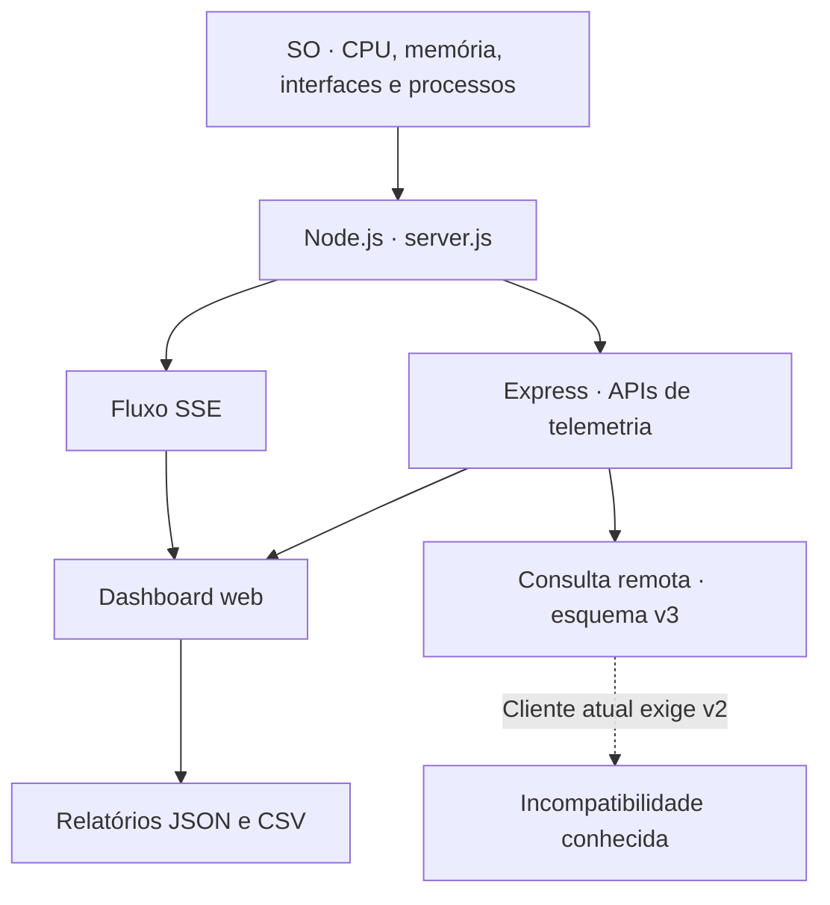

# NEXUS OS Omega V3 — Projeto da Aula 07

 

[Voltar à Aula 07](../README.md) · [Índice da disciplina](../../README.md)

Dashboard de monitoramento em português que apresenta métricas do sistema operacional, do processo Node.js e do serviço HTTP. O projeto está na versão **3.1.0**, conforme o [package.json](package.json).

As métricas são coletadas no ambiente que executa o servidor. Ao acessar uma instância em nuvem, o painel apresenta os recursos visíveis àquela instância.

## Estrutura

| Arquivo | Função |
|---|---|
| [server.js](server.js) | Servidor Express, coleta de métricas, APIs, HTML, CSS e JavaScript da interface. |
| [package.json](package.json) | Dependências, scripts e versão mínima do Node.js. |
| [package-lock.json](package-lock.json) | Versões das dependências resolvidas pelo npm. |
| [.gitignore](.gitignore) | Regras de exclusão de dependências, arquivos de ambiente e logs. |

Toda a aplicação está concentrada em `server.js`.

## Instalação e execução

Requisitos: **Node.js 18 ou superior** e npm.

Execute na pasta que contém este README:

```bash
npm ci
npm start
```

O servidor escuta em `0.0.0.0` e utiliza a porta 3000 por padrão.

### Desenvolvimento

```bash
npm run dev
```

O script de desenvolvimento executa `node --watch server.js`.

### Outra porta

Em um terminal Bash:

```bash
PORT=3001 npm start
```

As dependências declaradas são Express `^5.1.0` e Helmet `^8.1.0`.

## Métricas e informações

| Grupo | Informações disponíveis |
|---|---|
| CPU | Uso médio e por núcleo, média e pico recentes, modelo, clock e carga média. |
| Memória | RAM total, livre e utilizada; RSS, heap e memória externa do processo. |
| Runtime | Versões do Node.js e do V8, uso e atraso do event loop, eventos de coleta de lixo e estatísticas do heap. |
| Sistema operacional | Hostname, plataforma, kernel, arquitetura e tempo de atividade. |
| Rede | Interfaces e endereços de rede, com identificação de um endereço IPv4 principal. |
| HTTP | Quantidade de requisições, duração média, classes de status e taxa de erros do próprio serviço. |
| Projeto | Quantidade de arquivos e diretórios, tamanho e distribuição por extensão. |
| Armazenamento | Espaço do volume em que o projeto está localizado, quando a coleta é suportada. |
| Processos | Nome, PID, CPU e memória dos processos visíveis ao sistema. |
| Sessão | Médias, picos, percentis e desvios em relação às amostras recentes. |

A análise de arquivos ignora `node_modules` e `.git`. O indicador HTTP acompanha as requisições do Express; ele não mede a largura de banda de todas as interfaces.

## Rotas HTTP

| Método | Caminho | Resposta |
|---|---|---|
| GET | `/` | Dashboard HTML. |
| GET | `/api/dashboard` | JSON com a telemetria completa em `data`. |
| GET | `/api/public-snapshot` | Resumo de telemetria com o esquema `nexus-os-live-v3`. |
| OPTIONS | `/api/public-snapshot` | Resposta 204 para a consulta entre origens. |
| GET | `/api/stream` | Fluxo SSE com eventos `telemetry` e eventos `fault` em caso de falha na coleta. |
| GET | `/api/health` | JSON de disponibilidade com `success: true` e `status: "online"`. |

## Atualização da telemetria

| Componente | Intervalo ou limite |
|---|---|
| CPU | Amostragem a cada 1 segundo e histórico de até 60 valores. |
| SSE | Atualização a cada 1,5 segundo. |
| Perfis da interface | 1 s, 1,5 s, 3 s ou 5 s. |
| Lista de processos | Atualização a cada 5 segundos, com até 14 itens. |
| Análise de arquivos | Cache de 30 segundos. |
| Sessão no servidor | Até 180 amostras. |
| Gravação no navegador | Até 600 registros, exportáveis em CSV. |

O perfil de 1,5 segundo utiliza SSE quando disponível. Os demais perfis utilizam consultas periódicas, que também servem como alternativa em caso de falha no fluxo SSE. Os históricos ficam em memória.

## Interface

- Cinco temas: Cyber Cyan, Quantum Violet, Matrix Emerald, Crimson Reactor e Solar Gold.
- Neon suave, intenso ou desligado.
- Modo de observação com reforço de contraste.
- Pausa da telemetria, apresentação, tela cheia e controle dos efeitos visuais.
- Filtro de processos por nome ou PID e ordenação por CPU, memória, nome ou PID.
- Paleta de comandos com `Ctrl+K` ou `Cmd+K`, navegação pelas teclas de seta, execução com Enter e fechamento com Esc.

As preferências de tema, neon, perfil e ordenação são salvas no `localStorage` do navegador.

## Relatórios e comparação

A interface permite exportar ou copiar um relatório JSON no formato `nexus-os-report-v1`. Dois relatórios desse formato podem ser importados para comparação. As sessões gravadas no navegador são exportadas em CSV.

O NEXUS LINK consulta a rota `/api/public-snapshot` de outra instância. Na versão atual, existe uma diferença entre os esquemas do servidor e do cliente remoto: o servidor retorna `nexus-os-live-v3`, enquanto `fetchRemote` aceita `nexus-os-live-v2`. Por isso, o cliente rejeita o resumo de outra instância que executa este mesmo código.

## Saúde e processos

A pontuação de saúde combina CPU, memória, runtime, event loop e API. É um indicador heurístico do próprio dashboard, com as classificações ÓTIMO, SAUDÁVEL, ATENÇÃO e CRÍTICO.

O observador de processos permite apenas a consulta de informações. Ele utiliza PowerShell no Windows e `ps` no Linux. Se a enumeração não estiver disponível, apresenta apenas o processo Node.js. No Windows, o campo de CPU corresponde ao tempo acumulado de uso da CPU; no Linux, corresponde ao percentual retornado por `ps`.

As rotas de leitura não possuem autenticação. A telemetria inclui informações do ambiente, como hostname, interfaces e processos; o resumo público contém um conjunto menor de campos.

## Recursos visuais

Chart.js é carregado de `cdn.jsdelivr.net`; Lucide, de `unpkg.com`; e as fontes, de `fonts.googleapis.com` e `fonts.gstatic.com`. Os gráficos dependem do carregamento do Chart.js; quando ele não está disponível, o código mantém a atualização dos indicadores textuais.

## Publicação no Render

Para um Web Service configurado com esta pasta como diretório da aplicação:

| Campo | Comando |
|---|---|
| Build Command | `npm ci` |
| Start Command | `npm start` |

O servidor utiliza a variável `PORT` fornecida pelo ambiente. Para a apresentação no OBS descrita no material do projeto, execute a aplicação e configure sua página como fonte de navegador.

## Conferir o servidor

Com o processo iniciado, execute em outro terminal:

```bash
curl --fail --silent http://127.0.0.1:3000/api/health
curl --fail --silent http://127.0.0.1:3000/api/dashboard
```

Para observar o fluxo SSE, use `curl -N http://127.0.0.1:3000/api/stream` e interrompa a consulta com `Ctrl+C` após receber um evento `telemetry`. Se utilizar outra porta, ajuste os comandos.

---

## Visão de arquitetura



## Primeiro acesso em cinco comandos

Na pasta raiz do repositório da disciplina:

```bash
cd Aula-7/NEXUS-OS-OMEGA-V3-REFINADO-PTBR
npm ci
npm start
```

Abra **http://localhost:3000** e confira **http://localhost:3000/api/health**. Interrompa o processo com `Ctrl+C`.

## FAQ técnico

| Pergunta | Resposta baseada na implementação |
|---|---|
| O monitor mede meu computador quando uso um site remoto? | Não. Mede o host/container do **servidor Node.js**. |
| Existe banco de dados? | Não há persistência de amostras em banco; o histórico no servidor é temporário. |
| O observador encerra processos? | Não; opera em **somente leitura**. |
| Há autenticação nos endpoints? | Não; trate a exposição de telemetria com cuidado. |
| O NEXUS LINK conecta duas cópias desta versão? | Não diretamente: a API publica esquema v3 e o cliente remoto valida v2. |
| A aplicação requer `npm run build`? | Não. O script `start` executa `node server.js`. |
| O Render pode atribuir uma porta diferente? | Sim. O servidor utiliza `process.env.PORT`. |

## Fontes técnicas e documentação

| Assunto | Referência |
|---|---|
| Código e contratos das rotas | [server.js](server.js) |
| Dependências, versão e scripts | [package.json](package.json) |
| Contexto da atividade | [Aula 07](../README.md) |
| SSE no navegador | [MDN — Server-sent events](https://developer.mozilla.org/en-US/docs/Web/API/Server-sent_events) |
| Node.js e informações do host | [Node.js `os`](https://nodejs.org/api/os.html) |
| Deploy de aplicações Express | [Render Docs](https://render.com/docs/deploy-node-express-app) |
