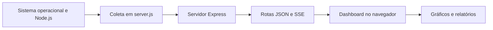

# 📊 NEXUS OS Omega V3 — Dashboard da Aula 07

[← Aula 07](../README.md) · [↑ Índice da disciplina](../../README.md)

O **NEXUS OS Omega V3** é um dashboard desenvolvido com Node.js e Express para observar informações do sistema operacional, do processo Node.js e das requisições recebidas pelo servidor. A interface está em português e reúne indicadores, gráficos, filtros e recursos de exportação.

**Versão registrada em `package.json`:** `3.1.0` · **Node.js:** 18 ou superior.

## ✨ Recursos disponíveis

| Área | Informações e funcionalidades |
|---|---|
| CPU | Utilização geral e por núcleo, médias, picos e informações do processador. |
| Memória | RAM do sistema e memória utilizada pelo processo Node.js. |
| Sistema operacional | Plataforma, versão, arquitetura, nome da máquina e tempo de atividade. |
| Rede | Interfaces e endereços disponíveis no ambiente. |
| Runtime | Versões do Node.js e do V8, heap e indicadores do event loop. |
| HTTP | Quantidade e tempo de resposta das requisições atendidas pelo Express. |
| Processos | Consulta, filtragem e ordenação dos processos visíveis, sem possibilidade de encerrá-los. |
| Arquivos | Quantidade, tamanho e distribuição dos arquivos analisados no projeto. |
| Armazenamento | Informações sobre o volume, quando a coleta é suportada. |
| Relatórios | Exportação de JSON, comparação por importação e exportação de sessões em CSV. |

A interface oferece cinco temas — **Cyber Cyan, Quantum Violet, Matrix Emerald, Crimson Reactor e Solar Gold** —, além de ajustes de neon, apresentação em tela cheia, pausa da atualização e uma paleta de comandos acessível por `Ctrl+K` ou `Cmd+K`.

## 🧱 Estrutura e tecnologias

A implementação está concentrada em [`server.js`](server.js), responsável pela coleta de informações, pelas rotas HTTP e pelo código da interface. As dependências e os scripts estão definidos em [`package.json`](package.json).

| Tecnologia | Utilização |
|---|---|
| Node.js | Ambiente de execução do servidor e acesso às informações do sistema. |
| Express | Definição das rotas HTTP e entrega da interface. |
| Helmet | Configuração de cabeçalhos de segurança HTTP. |
| HTML, CSS e JavaScript | Interface do dashboard. |
| SSE (*Server-Sent Events*) | Envio periódico de telemetria ao navegador. |



## ⚙️ Instalação e execução

**Pré-requisitos:** Node.js 18 ou superior e npm.

Na pasta deste projeto:

```bash
npm ci
npm start
```

Abra **http://localhost:3000**. O servidor utiliza `0.0.0.0` como endereço de escuta e a porta `3000` por padrão, mas aceita outra porta pela variável de ambiente `PORT`.

Para executar o modo de desenvolvimento com reinício automático:

```bash
npm run dev
```

O script utiliza `node --watch server.js`. O arquivo `package.json` não declara uma suíte de testes automatizados.

## 🌐 Rotas HTTP

| Método | Rota | Resposta |
|---|---|---|
| `GET` | `/` | Interface web do dashboard. |
| `GET` | `/api/dashboard` | Telemetria completa em JSON. |
| `GET` | `/api/public-snapshot` | Resumo da telemetria no esquema `nexus-os-live-v3`. |
| `OPTIONS` | `/api/public-snapshot` | Resposta de preflight com status 204. |
| `GET` | `/api/stream` | Fluxo SSE com eventos `telemetry` e `fault`. |
| `GET` | `/api/health` | Indicador de disponibilidade do servidor. |

Para consultar a API localmente:

```bash
curl http://localhost:3000/api/health
curl http://localhost:3000/api/dashboard
curl -N http://localhost:3000/api/stream
```

A consulta ao fluxo SSE permanece aberta para receber eventos. Encerre-a com `Ctrl+C` quando desejar.

## ⏱️ Atualização das métricas

| Componente | Intervalo ou limite definido no projeto |
|---|---|
| Coleta de CPU | Aproximadamente a cada 1 segundo, com histórico de até 60 valores. |
| Atualização por SSE | A cada 1,5 segundo. |
| Perfis de atualização da interface | 1, 1,5, 3 ou 5 segundos. |
| Atualização da lista de processos | A cada 5 segundos, com até 14 processos exibidos. |
| Análise de arquivos | Cache de 30 segundos. |
| Histórico do servidor | Até 180 amostras em memória. |
| Gravação no navegador | Até 600 registros por sessão, exportáveis em CSV. |

As preferências da interface são armazenadas no `localStorage` do navegador. Os históricos mantidos no processo Node.js são perdidos quando o servidor reinicia.

## 📄 Relatórios e comparação

A interface permite exportar ou copiar relatórios JSON no formato `nexus-os-report-v1`. Dois relatórios desse formato podem ser importados para comparação. As amostras registradas no navegador também podem ser exportadas em CSV.

**Atenção ao NEXUS LINK:** o servidor gera resumos no esquema `nexus-os-live-v3`, mas o cliente remoto `fetchRemote` espera `nexus-os-live-v2`. Dessa forma, duas instâncias com esta implementação **não realizam diretamente a comparação remota**. A comparação pela importação de relatórios JSON é independente dessa funcionalidade.

## ⚠️ Limitações e segurança

- **Telemetria sem autenticação:** os endpoints não exigem login e podem revelar dados do ambiente, como nome da máquina, interfaces e processos.
- **Origem das métricas:** quando o dashboard está hospedado na nuvem, ele apresenta as informações acessíveis ao servidor ou container, e não as do computador do visitante.
- **Consulta de processos:** a coleta utiliza PowerShell no Windows e `ps` no Linux. Se não for possível listar outros processos, o painel pode mostrar somente o processo Node.js.
- **Métrica de CPU dos processos:** no Windows, o valor consultado representa tempo acumulado de CPU; no Linux, corresponde ao percentual retornado por `ps`. Por isso, os dois valores não devem ser interpretados como medidas diretamente equivalentes.
- **Recursos externos:** gráficos dependem do Chart.js carregado pela rede. A interface também utiliza Lucide e fontes externas.
- **Indicadores de saúde:** os alertas seguem critérios definidos no próprio código; não são resultados de um benchmark padronizado.

## ☁️ Publicação no Render

Para configurar um Web Service com a pasta deste projeto como diretório raiz:

| Campo | Valor |
|---|---|
| Root Directory | `Aula-7/NEXUS-OS-OMEGA-V3-REFINADO-PTBR`, se o deploy partir da raiz do repositório da disciplina. |
| Build Command | `npm ci` |
| Start Command | `npm start` |
| Porta | Definida pelo ambiente por meio de `PORT`. |

O projeto também pode ser apresentado no **OBS Studio** como fonte do tipo Navegador, conforme a proposta da aula.

## 📚 Referências

- [Código do dashboard](server.js)
- [Dependências e scripts](package.json)
- [Resumo da Aula 07](../Resumo_Aula_07_Nuvem_Sistemas_Operacionais.md)
- [Node.js — Módulo `os`](https://nodejs.org/api/os.html)
- [MDN — Server-Sent Events](https://developer.mozilla.org/en-US/docs/Web/API/Server-sent_events)
- [Render — Deploy Node/Express](https://render.com/docs/deploy-node-express-app)
