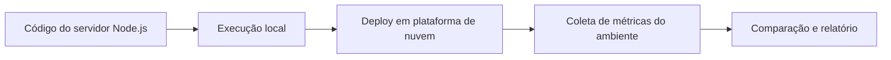

# Aula 07 — Nuvem e Sistemas Operacionais

[Aula 06](../Aula-6/README.md) · [Índice da disciplina](../README.md)

## 🎮 Fase 07 · Desafio de nuvem e monitoramento

> **Objetivo:** Percorra a cadeia código → servidor local → telemetria → plataforma remota → análise crítica. XP indica **progresso didático opcional** e não é calculado automaticamente nem faz parte da avaliação oficial.

| Checkpoint | Missão | Evidência consultável | XP |
|---|---|---|--:|
| Boot | Instalar dependências e iniciar o NEXUS OS | [Projeto Node.js](NEXUS-OS-OMEGA-V3-REFINADO-PTBR/README.md) | 15 |
| Observação | Distinguir indicadores do host e do processo | [`server.js`](NEXUS-OS-OMEGA-V3-REFINADO-PTBR/server.js) | 20 |
| Cloud | Explicar configuração do Web Service | [Orientações de implantação](#implantação-no-render--parâmetros-do-projeto) | 20 |
| Relatório | Definir variáveis para comparar duas execuções | [Resumo da aula](Resumo_Aula_07_Nuvem_Sistemas_Operacionais.md) | 25 |

**Progresso manual**

- [ ] Conferi o `package.json` e a versão necessária do Node.js.
- [ ] Sei que uma instância na nuvem mostra métricas daquele ambiente.
- [ ] Registrei as limitações de compatibilidade v2/v3 do NEXUS LINK.
- [ ] Consigo indicar quais dados devem compor o relatório comparativo.

<details>
<summary><strong>🏅 Desafio opcional de excelência</strong></summary>

Projeto final opcional: coletar duas amostras reais (local e cloud), anotar contexto e comparar CPU, memória e uptime sem assumir igualdade entre plataformas.

</details>

**Nota técnica:** A publicação em cloud e a comparação dependem de execução real; não há medições atuais embutidas no README.

---


Estudo de aplicações Node.js com Express, monitoramento do sistema operacional e publicação em nuvem.

## Materiais

| Material | Conteúdo |
|---|---|
| [Resumo da aula](Resumo_Aula_07_Nuvem_Sistemas_Operacionais.md) | Express, CORS, Render, deploy e comparação entre ambientes. |
| [Projeto NEXUS OS](NEXUS-OS-OMEGA-V3-REFINADO-PTBR/README.md) | Instruções de instalação, execução e uso do dashboard. |
| [Código da aplicação](NEXUS-OS-OMEGA-V3-REFINADO-PTBR/server.js) | Servidor, coleta de métricas e interface do NEXUS OS. |
| [Manifesto npm](NEXUS-OS-OMEGA-V3-REFINADO-PTBR/package.json) | Dependências, scripts e versão exigida do Node.js. |

## Objetivo da aula

Evoluir uma aplicação que apresenta informações básicas do sistema operacional para um dashboard com indicadores de CPU, memória, tempo de atividade, rede e ambiente de execução.

A proposta inclui publicar a aplicação no Render, escolher uma segunda plataforma e elaborar um relatório comparativo dos ambientes.

## Executar o NEXUS OS

Com Node.js 18 ou superior e npm disponíveis, execute a partir desta pasta:

```bash
cd NEXUS-OS-OMEGA-V3-REFINADO-PTBR
npm ci
npm start
```

O arquivo de entrada do projeto é `server.js`, e suas dependências são Express e Helmet. O servidor usa a porta 3000 por padrão. Para desenvolvimento com reinício automático, execute `npm run dev` na pasta da aplicação.

## Recursos do projeto

- Coleta de métricas do sistema e do processo Node.js.
- Atualização por SSE ou consultas periódicas.
- Observação de processos em modo somente leitura.
- Cinco temas, ajustes de neon e modo de observação.
- Paleta de comandos.
- Exportação de relatórios em JSON e de sessões em CSV.
- Comparação por importação de relatórios.

Os endpoints e a limitação de compatibilidade do link remoto estão descritos no [guia do NEXUS OS](NEXUS-OS-OMEGA-V3-REFINADO-PTBR/README.md).

## Relatório comparativo

O resumo da aula propõe comparar a facilidade de deploy, o sistema operacional, a CPU, a memória, a arquitetura, a versão do Node.js, o IP, o tempo de atividade e os recursos das plataformas.

Preencha o relatório com dados coletados em cada ambiente. A comparação deve identificar a plataforma e o contexto da coleta.

## Endereço registrado no projeto

[Dashboard no Render](https://dashboard-monitoramento-1.onrender.com/)

---

## Fluxo da atividade em nuvem



## Checklist técnico para reproduzir o projeto

- [ ] Conferir o [package.json](NEXUS-OS-OMEGA-V3-REFINADO-PTBR/package.json) e ter Node.js 18 ou superior.
- [ ] Executar `npm ci` na pasta do projeto.
- [ ] Executar `npm start` e abrir `http://localhost:3000`.
- [ ] Consultar `/api/health` e `/api/dashboard`.
- [ ] Publicar a aplicação numa plataforma adequada, informando os comandos de build e inicialização.
- [ ] Registrar os valores efetivamente observados em cada ambiente.
- [ ] Interpretar diferenças de CPU, memória, rede e uptime considerando os limites do container ou serviço.

## Implantação no Render — parâmetros do projeto

| Campo | Configuração |
|---|---|
| Diretório raiz | `Aula-7/NEXUS-OS-OMEGA-V3-REFINADO-PTBR`, caso publique a partir deste repositório |
| Build command | `npm ci` |
| Start command | `npm start` |
| Porta | Definida pelo ambiente (`PORT`), com padrão local 3000 |

O projeto expõe telemetria sem autenticação; avalie o ambiente antes de disponibilizar dados do host publicamente. A função de conexão remota NEXUS LINK ainda possui uma incompatibilidade entre esquemas v2/v3, detalhada no [README técnico do NEXUS OS](NEXUS-OS-OMEGA-V3-REFINADO-PTBR/README.md).

**Documentação complementar:** [Deploy Node/Express no Render](https://render.com/docs/deploy-node-express-app) · [Módulo `os` do Node.js](https://nodejs.org/api/os.html).
