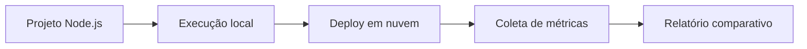

# ☁️ Aula 07 — Nuvem e Sistemas Operacionais

[← Aula 06](../Aula-6/README.md) · [Índice da disciplina](../README.md)

Estudo de Node.js, Express, indicadores do sistema operacional e publicação de serviços web em nuvem, culminando num **dashboard de observabilidade**.

## 📂 Materiais da aula

| Arquivo | Descrição |
|---|---|
| [Resumo da Aula 07](Resumo_Aula_07_Nuvem_Sistemas_Operacionais.md) | Express, CORS, Render, comparação entre ambientes e deploy |
| [README do NEXUS OS](NEXUS-OS-OMEGA-V3-REFINADO-PTBR/README.md) | Arquitetura, instalação, API e limitações |
| [server.js](NEXUS-OS-OMEGA-V3-REFINADO-PTBR/server.js) | Implementação das rotas, coleta e interface |
| [package.json](NEXUS-OS-OMEGA-V3-REFINADO-PTBR/package.json) | Scripts, dependências e versão mínima do Node.js |

## 🎯 Objetivo técnico

Evoluir o conceito de um monitor básico para uma aplicação que observe **CPU, memória, runtime, rede, processos e tempo de atividade**, comparando o que está disponível num computador local com o que pode ser observado num serviço em nuvem.



## ⚙️ Executar o NEXUS OS

**Pré-requisito:** Node.js 18+ e npm. A partir desta pasta:

```bash
cd NEXUS-OS-OMEGA-V3-REFINADO-PTBR
npm ci
npm start
```

Acesse `http://localhost:3000` ou a porta definida em `PORT`. Para desenvolvimento, o manifesto possui o script `npm run dev`.

## ☁️ Configuração de Web Service no Render

Caso o serviço seja publicado diretamente a partir do repositório da disciplina:

| Parâmetro | Valor sugerido pelo projeto |
|---|---|
| Root Directory | `Aula-7/NEXUS-OS-OMEGA-V3-REFINADO-PTBR` |
| Build Command | `npm ci` |
| Start Command | `npm start` |
| Porta | Variável `PORT` do ambiente |

**Endereço registrado no material:** [Dashboard no Render](https://dashboard-monitoramento-1.onrender.com/). É uma referência registrada, não uma confirmação de disponibilidade atual.

## 📊 Relatório entre ambientes

O material propõe observar facilidade de publicação, plataforma e sistema operacional, CPU, RAM, arquitetura, versão do Node.js, IP, uptime e recursos do serviço.

Para uma comparação válida, registre **data da coleta, plataforma, carga de trabalho e limites do host/container**. As métricas do servidor remoto não equivalem às do navegador do visitante.

## ⚠️ Pontos de atenção

O NEXUS LINK presente no dashboard possui incompatibilidade de esquema entre resumo v3 e cliente v2. A aplicação também expõe telemetria sem autenticação. Consulte as limitações no [guia técnico do NEXUS OS](NEXUS-OS-OMEGA-V3-REFINADO-PTBR/README.md).

**Referências:** [Render Docs](https://render.com/docs/deploy-node-express-app) · [Node.js `os`](https://nodejs.org/api/os.html).
