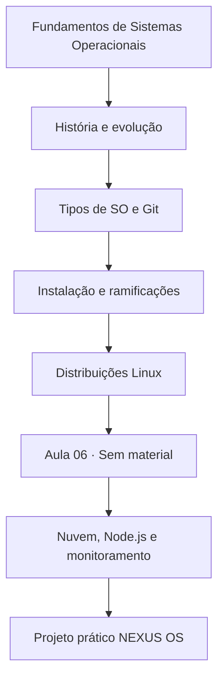
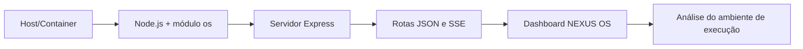

# Sistemas Operacionais

 


## 🎓 Campanha acadêmica · Sistemas Operacionais

> **Como jogar (com propósito):** cada aula é uma fase de aprendizado. Avance pelo material real, conclua um pequeno desafio e registre suas conclusões. O sistema de XP é **simbólico e manual**, sem classificação oficial ou integração com notas.

| Fase | Missão de estudo | Material de referência | XP didático |
|:--:|---|---|--:|
| 01 · Fundamentos | Explicar kernel, modos e recursos gerenciados | [Aula 01](Aula-1/README.md) | 15 |
| 02 · História | Comparar processamento em lote e multiprogramação | [Aula 02](Aula-2/README.md) | 20 |
| 03 · Ecossistemas | Distinguir tipos de SO e configurar identidade Git | [Aula 03](Aula-3/README.md) | 20 |
| 04 · Instalação | Relacionar instalação Windows a drivers e arquivos | [Aula 04](Aula-4/README.md) | 20 |
| 05 · Decisões | Selecionar uma distribuição Linux por cenário | [Aula 05](Aula-5/README.md) | 20 |
| 06 · Pausa informativa | Consultar o estado do material, sem inventar conteúdo | [Aula 06](Aula-6/README.md) | — |
| 07 · Laboratório | Executar e explicar o monitor NEXUS OS | [Aula 07](Aula-7/README.md) | 35 |

**Progresso acadêmico**

- [ ] Entendo kernel, processos e gerenciamento de memória.
- [ ] Sei relacionar marcos históricos às mudanças de hardware.
- [ ] Consigo diferenciar sistemas móveis, servidores, embarcados e tempo real.
- [ ] Consultei os exercícios de instalação e a comparação de Linux.
- [ ] Configurei Git e consegui abrir a aplicação prática da Aula 07.

<details>
<summary><strong>🎖️ Conquistas pedagógicas</strong></summary>

| Conquista | Critério |
|---|---|
| 🔎 Explorador de sistemas | Explicar as camadas conceituais do SO |
| 🧩 Integrador | Relacionar arquitetura, evolução e cenários de uso |
| 🛠️ Praticante | Executar e compreender os indicadores do NEXUS OS |
| 📈 Analista de nuvem | Interpretar a diferença entre host local e servidor remoto |

Esses marcos **não substituem as avaliações da disciplina**.

</details>

**💡 Boss final opcional:** produza uma comparação **com medições coletadas por você** entre execução local e em nuvem, registrando data, ambiente e limites da amostragem. O repositório não contém medições universais nem resultados automáticos.

---

Resumos, atividades e projeto prático da disciplina de Sistemas Operacionais.

**Professor:** Me. Deivison S. Takatu

**Contato:** [deivison.takatu@fatec.sp.gov.br](mailto:deivison.takatu@fatec.sp.gov.br)

## Conteúdo do repositório

| Aula | Tema | Material |
|---|---|---|
| 01 | Introdução aos sistemas operacionais | [Resumo e linha do tempo](Aula-1/README.md) |
| 02 | Evolução histórica dos sistemas operacionais | [Resumo e estudo detalhado](Aula-2/README.md) |
| 03 | Tipos de sistemas operacionais e introdução ao Git | [Resumo da aula](Aula-3/README.md) |
| 04 | Instalação do Windows e ramificações de sistemas | [Atividades](Aula-4/README.md) |
| 05 | Comparação de distribuições Linux | [Comparativo](Aula-5/README.md) |
| 06 | Material ainda não publicado; página de status e navegação. | [Aula 06](Aula-6/README.md) |
| 07 | Nuvem e monitoramento do sistema operacional | [Resumo e projeto NEXUS OS](Aula-7/README.md) |

## Temas de estudo

- **Estrutura do sistema operacional:** kernel, camadas e modos de execução.
- **Gerenciamento de recursos:** CPU, processos, memória e dispositivos.
- **Organização dos dados:** sistemas de arquivos e operações de entrada e saída.
- **Evolução dos sistemas:** processamento em lote, multiprogramação, computadores pessoais e dispositivos móveis.
- **Ambientes de execução:** distribuições Linux, execução local e serviços em nuvem.

A [Aula 01](Aula-1/README.md) apresenta os fundamentos. A [Aula 02](Aula-2/SO-modernos.md) aprofunda o estudo histórico. A [atividade de instalação do Windows](Aula-4/Atividade-1.md) aplica os conceitos de kernel, processos, threads, drivers e sistema de arquivos.

## Projeto prático: NEXUS OS

O projeto da Aula 07 é um dashboard desenvolvido com Node.js, Express e Helmet. Ele apresenta informações do sistema operacional e do processo Node.js, como CPU, memória, rede e tempo de atividade.

Com Node.js 18 ou superior e npm disponíveis, execute os comandos a partir da raiz deste repositório:

```bash
cd Aula-7/NEXUS-OS-OMEGA-V3-REFINADO-PTBR
npm ci
npm start
```

O servidor utiliza a porta 3000 por padrão. As instruções de desenvolvimento e as descrições das rotas e dos recursos estão no [README do projeto](Aula-7/NEXUS-OS-OMEGA-V3-REFINADO-PTBR/README.md).

## Avaliação

A fórmula apresentada na introdução da disciplina é:

```text
Média = (P1 × 0,25) + (P2 × 0,25) + ((PJ + AT) × 0,25)
```

| Sigla | Significado |
|---|---|
| P1 | Primeira prova |
| P2 | Segunda prova |
| PJ | Projeto |
| AT | Atividades |

As propostas de entrega estão nos materiais de cada aula. A Aula 01 orienta a formação de grupos de três a cinco integrantes e a organização das atividades em um repositório GitHub.

## Referências bibliográficas

- TANENBAUM, A. S.; BOS, H. *Sistemas Operacionais Modernos*. 4. ed. São Paulo: Pearson, 2016.
- SILBERSCHATZ, A.; GALVIN, P. B.; GAGNE, G. *Fundamentos de Sistemas Operacionais*. 9. ed. Rio de Janeiro: LTC, 2015.
- STALLINGS, W. *Sistemas Operacionais: Conceitos e Projetos*. 8. ed. São Paulo: Pearson, 2015.
- DENARDIN, G. W.; BARRIQUELLO, C. H. *Sistemas Operacionais de Tempo Real e sua Aplicação em Sistemas Embarcados*. Porto Alegre: Editora da UFRGS, 2014.
- AWASTHI, A.; RAWAT, V. *Ramificação e Tarefas do Sistema Operacional*. Edições Nosso Conhecimento, 2023.
- DOWNEY, A. B. *Think OS: A Brief Introduction to Operating Systems*. Green Tea Press, 2015.
- RED HAT. *Red Hat Enterprise Linux — System Administration Guide*. Documentação oficial.
- DOCKER INC. [*Docker Documentation*](https://docs.docker.com/).

---

## Percurso visual da disciplina



## Quadro de navegação

| Etapa | Aprendizado | Entrega ou material |
|---|---|---|
| 01 | Kernel, processos, memória, E/S | [Resumo e linha do tempo](Aula-1/README.md) |
| 02 | Gerações e história dos SO | [Estudo detalhado](Aula-2/SO-modernos.md) |
| 03 | Tipos de SO e identidade Git | [Aula 03](Aula-3/README.md) |
| 04 | Instalação e famílias de SO | [Atividade 1](Aula-4/Atividade-1.md) · [Atividade 2](Aula-4/Atividade-2.md) |
| 05 | Comparar distribuições Linux | [Aula 05](Aula-5/README.md) |
| 06 | Conteúdo não disponibilizado | [Situação da pasta](Aula-6/README.md) |
| 07 | Computação em nuvem e telemetria | [Resumo](Aula-7/Resumo_Aula_07_Nuvem_Sistemas_Operacionais.md) · [Projeto](Aula-7/NEXUS-OS-OMEGA-V3-REFINADO-PTBR/README.md) |

## Tecnologia aplicada no projeto final



| Ferramenta | Papel |
|---|---|
| [Node.js](https://nodejs.org/) | Runtime JavaScript do servidor |
| [Express](https://expressjs.com/) | Rotas e respostas HTTP |
| [Render](https://render.com/docs) | Plataforma de publicação tratada na aula |
| [Git](https://git-scm.com/docs) | Controle de versões das atividades |
| [GitHub Markdown](https://docs.github.com/pt/get-started/writing-on-github) | Registro e apresentação do material |

## Como navegar por este repositório

Os READMEs das aulas funcionam como **índices resumidos**, enquanto os arquivos `.md` mais extensos concentram os estudos e as atividades. Para reproduzir o painel da Aula 07, consulte os passos de instalação no [README do NEXUS OS](Aula-7/NEXUS-OS-OMEGA-V3-REFINADO-PTBR/README.md).

**Observação:** os arquivos representam material acadêmico e experimentos. Dados de telemetria e comparações entre plataformas precisam ser coletados no ambiente real de execução; o repositório não oferece medições universais ou atuais dos servidores.
